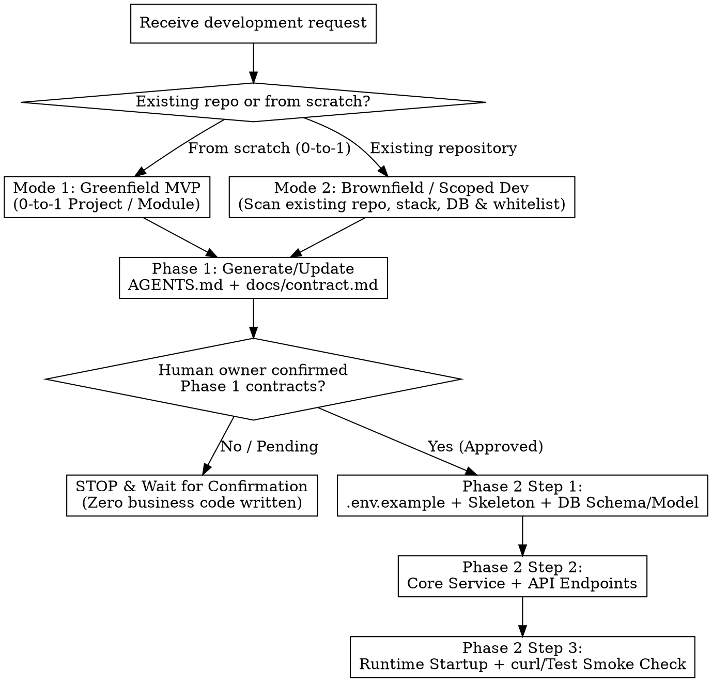

# Contract-First MVP & Scoped Development Skill (`dev-skill`)

## Overview

Turn vague, one-sentence feature requests from novices or teammates (such as *"我要做后端的订单模块"* or *"帮我写个校园二手交易系统"*) into bounded, contract-governed, step-by-step verifiable software deliveries.

Alongside `drawing-skill` (architecture/mechanism diagrams) and `writing-skill` (evidence-governed technical documents), `dev-skill` governs the **AI-assisted development lifecycle**:

> **1. Contract Gate before business code (`契约先行，点头再动代码`).** Never write business code directly from a one-sentence request. First converge the request into `AGENTS.md` (master steering file) and `docs/contract.md` (database schema & API contract), then stop for human confirmation.
> **2. Contract is the single source of truth (`契约即唯一真相`).** Table names, column names, state enums, route paths, and request/response JSON keys in implementation code must match `docs/contract.md` 100%. Never let code and contracts drift apart.
> **3. Stepwise execution with real verification (`小步快跑，真实命令验收`).** After contract confirmation, build in three verifiable steps (Skeleton & Schema → Core Endpoints → Smoke Verification) and execute the verification commands in `AGENTS.md` at every step.

**Violating the letter of the Phase 1 Contract Gate is violating the spirit of this skill.**

---

## Mode Routing & Workflow

| Mode | Triggering Scenario | Mandatory First Action |
|---|---|---|
| **Mode 1 — 从零立项 (`Greenfield MVP`)** | Starting a new project or standalone service from an empty workspace or a single sentence (e.g., *"我要做后端的二手书交易模块"*). | Do **not** scaffold business logic. Converge requirements and generate root `AGENTS.md` + `docs/contract.md` using `templates/AGENTS.template.md` and `templates/contract.template.md`. |
| **Mode 2 — 已有仓库开发 / 子模块扩展 (`Brownfield / Scoped Dev`)** | Adding a feature, module, or endpoint inside an existing repository owned by a team. | **Pre-Contract Recon**: Inspect the repo's directory tree, dependency manifest (`package.json` / `pom.xml` / `go.mod` / `requirements.txt`), existing `AGENTS.md`, database migrations/entities, and unified response wrappers. Define an explicit file whitelist before drafting or updating `AGENTS.md` + `docs/contract.md`. |

### Mode 2 Pre-Contract Recon Rules (Brownfield Only)

Before writing a single line of `AGENTS.md` or `docs/contract.md` in an existing repository:
1. **Reuse existing stack and conventions**: Follow the repository's existing language version, web framework, ORM, error-code envelope, and config loader. Never introduce a second ORM, router, or logging library.
2. **Establish a File Whitelist**: List the exact directories and files this task is allowed to create or modify. Adjacent modules are read-only context.
3. **Protect Existing Contracts**: Never rename existing database columns, alter existing API response structures, or break shared middleware unless explicitly instructed by the human owner.

---

## Phase 1 — Hard Contract Gate (`契约门禁：点头前绝不写业务代码`)

When the user gives a vague or one-sentence requirement, **STOP in Phase 1**. Produce the following two contract files (using `templates/AGENTS.template.md` and `templates/contract.template.md`) and present them for human confirmation.

### Artifact 1: `AGENTS.md` (Master Steering Contract)

Place `AGENTS.md` in the repository root (Mode 1) or repository/submodule root (Mode 2). It must contain four fixed sections:

1. **MVP 最小闭环（Scope & Non-Goals）**
   - **In-Scope (`本轮必做`)**: 3–5 concrete, user-observable or API-verifiable actions that form the minimum closed loop.
   - **Non-Goals (`本轮明确不做`)**: Explicitly exclude unrequested complexity (e.g., no distributed microservices, no full RBAC permission center, no Kafka/RabbitMQ, no real third-party payment gateway, no Elasticsearch) so AI agents do not over-engineer.
2. **Architecture 总体框架与目录树（Architecture & Directory Tree）**
   - **Tech Stack & Rationale**: Choose a simple, battle-tested stack that teammates can start locally in <5 minutes (e.g., FastAPI + SQLite/MySQL, Spring Boot + MySQL, Express/NestJS + Prisma, Go Gin + GORM).
   - **Layered Responsibilities**: Define clear boundaries (`Router/Controller` handles HTTP validation → `Service` handles business rules & state transitions → `Repository/DAO` handles DB persistence → `DB`).
   - **Directory Tree Preview**: Exact file-level tree showing where every file will live.
3. **环境与启动/校验约定（Environment & Verification）**
   - **Runtime & Database**: Exact language/runtime version and database setup mode.
   - **Environment Variables Table**: Variable name, example value, required/optional, and purpose (must match `.env.example`).
   - **One-Command Startup**: Exact commands to install dependencies, initialize the database, and start the server.
   - **Mandatory Verification Commands**: Exact `build`, `pytest`/`npm test`/`go test`, and `curl` smoke-test commands that the AI agent must run after each coding step.
4. **Agent 编码红线（Guardrails）**
   - **Allowed Scope (Whitelist)**: Exact paths the agent may create or edit.
   - **Forbidden Boundaries**: Paths, tables, and configs the agent must not touch.
   - **Coding & Error Conventions**: Unified JSON response envelope, error handling, no hardcoded secrets, and ban on unapproved heavy dependencies or paid APIs.

### Artifact 2: `docs/contract.md` (Database Schema & API Contract)

Place `docs/contract.md` in the `docs/` directory (or `docs/contracts/<module>-contract.md` in multi-module repos). It must contain three fixed sections:

1. **数据库与字段设计（Database Schema）**
   - **Table Overview & Field Dictionary**: For every table, provide table name, purpose, and a complete markdown table covering: `字段名 (Column)`, `类型与长度 (Type)`, `必填/可空 (Nullable)`, `默认值 (Default)`, `约束/索引 (Key/Index)`, and `业务含义与说明 (Description)`.
   - **State Enums & Transitions**: Explicitly enumerate every status/type field (e.g., `0=PENDING`, `1=PAID`, `2=CANCELLED` or string enums) and legal state transitions (`Allowed From -> To`). Never leave status values ambiguous.
   - **Executable DDL / Schema**: Copy-pasteable `CREATE TABLE` SQL or ORM schema definition.
2. **接口对接契约（API Contract）**
   - **Unified Response Envelope & Error Codes**: Standard JSON wrapper (`code`, `message`, `data`) and a concrete error-code table (`HTTP Status`, `Business Code`, `Scenario`).
   - **Endpoint Specifications**: For every endpoint, specify `Method + Path`, auth requirement, request parameters (`Path`, `Query`, `Headers`, `JSON Body` example with field types & validation rules), **Success Response JSON example**, and **Failure Response JSON example**.
   - **Frontend / Teammate Integration Notes**: Pagination rules, timestamp format (ISO-8601 with timezone or Unix ms), ID types, and CORS/prefix conventions.
3. **外部/上下游对接说明（Integration & Boundaries）**
   - Specify calls to other internal modules, third-party services, CLI tools, or scheduled jobs, including protocol, timeout/fallback behavior, and whether the integration is **Real** or **Mock** in this MVP.

### Phase 1 Gate Stop Condition

After writing or presenting `AGENTS.md` and `docs/contract.md`:
- **Do NOT write any `.py`, `.ts`, `.js`, `.java`, `.go`, or business implementation files.**
- Ask the human owner to confirm:
  1. Is the MVP scope (3–5 core actions & Non-Goals) right?
  2. Do the table fields and state enums match their expectations?
  3. Are the API paths and request/response JSON formats ready for frontend/teammate integration?

---

## Phase 2 — Stepwise Verifiable Coding Discipline (`确认后分步开发纪律`)

Enter Phase 2 **only after** the human owner explicitly approves the Phase 1 contracts.

### Step 1: 环境骨架与数据层（Environment, Skeleton & Schema）
1. Create `.env.example`, dependency manifest, and directory structure exactly as declared in `AGENTS.md`.
2. Create the database initialization script / migration and ORM models/entities matching `docs/contract.md` column-for-column (exact column names, types, defaults, and enum constants).
3. **Verify Step 1**: Run the schema initialization / syntax / build command from `AGENTS.md` and confirm zero errors before moving to Step 2.

### Step 2: 核心业务与接口实现（Service & API Implementation）
1. Implement Repository/DAO queries, Service-layer business rules (enforcing legal state transitions and validation), and Router/Controller handlers.
2. Ensure every route path, HTTP method, query/body key, response field name, and error code matches `docs/contract.md` 100%.
3. **Verify Step 2**: Run the compiler / linter / unit test suite from `AGENTS.md` and confirm passing output.

### Step 3: 真实启动与端到端冒烟验收（Runtime & Smoke Verification）
1. Start the application locally (or via test client) against a real local database instance (e.g., SQLite / local MySQL / Postgres / test container).
2. Execute the `curl` or automated smoke-test commands defined in `AGENTS.md` covering:
   - The complete MVP closed loop (happy path across the 3–5 core actions);
   - At least one validation or illegal-state error case (verifying the error code contract).
3. Record the **actual terminal output and HTTP responses** in the completion report. Never claim "endpoints work" without executing them.

### Contract Synchronization Protocol (`契约变更同步协议`)

If you discover during Phase 2 that a column name, data type, status enum, or API field needs adjustment:
1. **Update `docs/contract.md` (and `AGENTS.md` if architecture/commands change) FIRST.**
2. Explicitly list the contract diff in your response so frontend/teammates know what changed.
3. Update the code and re-run Step 3 smoke verification.

---

## Common Anti-Patterns (`新手一句话开发的 5 大翻车点与拦截规则`)

| # | Anti-Pattern (`常见翻车点`) | Symptom when Novice Says *"我要做后端的XX"* | `dev-skill` Interception Rule |
|---|---|---|---|
| **1** | **Zero-Contract Code Dump (`不写契约直接吐代码`)** | AI immediately generates 10+ code files; frontend teammate has no idea what fields or URLs exist. | **Hard Gate in Phase 1**: Zero business code before `AGENTS.md` + `docs/contract.md` are generated and confirmed. |
| **2** | **Scope Creep & Over-Engineering (`盲目加戏与过度设计`)** | User asks for a course MVP; AI drags in Redis cluster, RabbitMQ, JWT+OAuth2+RBAC, and Docker Swarm, making local startup impossible. | **`AGENTS.md` Non-Goals & Simple Stack Rule**: Restrict MVP to 3–5 core actions, list explicit Non-Goals, and pick a stack that starts locally in one command. |
| **3** | **Schema & API Drift (`代码与文档两张皮`)** | Contract says `book_price` (cents), code writes `price` (float); API returns `{status: "ok"}` instead of `{code: 0, data: ...}`. | **Single Source of Truth**: Code identifiers and JSON keys must match `docs/contract.md` 100%; any change requires updating `docs/contract.md` first. |
| **4** | **Fake-Done Stubs (`桩代码与假数据冒充完工`)** | Handler returns a hardcoded JSON array or leaves `# TODO: save to db` while AI claims "backend completed". | **Anti-Hallucination & Step 3 Smoke Test**: Every MVP endpoint must persist/query real data and pass live `curl`/test smoke checks; any intentional Mock must be labeled `[MOCK]` in both `docs/contract.md` and the report. |
| **5** | **Brownfield Collateral Damage (`已有仓库盲改乱动邻接模块`)** | Teammate asks to add one submodule; AI reformats global configs, renames shared user tables, and breaks existing routes. | **Mode 2 Recon & File Whitelist**: Scan existing repo first, lock allowed paths in `AGENTS.md` Guardrails, and treat all non-whitelisted files as read-only. |

---

## Rationalization Counter-Table (`常见借口反驳表`)

| Excuse (`AI 常见偷懒借口`) | Reality (`工程事实与铁律`) |
|---|---|
| *"The user's one-sentence request is simple enough to code directly."* | A one-sentence request hides 20 unspoken assumptions about fields, status enums, and API payloads. Write `AGENTS.md` + `docs/contract.md` first. |
| *"I'll write the code first and generate `docs/contract.md` afterwards."* | Contracts written after code rubber-stamp accidental bugs and give the human owner zero chance to steer scope before wasted work. Contract first, always. |
| *"Adding JWT auth, Redis caching, and message queues makes it more production-ready."* | Unrequested infrastructure breaks local startup for novice teammates. Put unrequested extras in **Non-Goals**. |
| *"I slightly renamed the JSON fields in the controller for convenience; frontend can adapt."* | Silent field drift breaks integration. Follow `docs/contract.md` 100% or run the Contract Synchronization Protocol first. |
| *"The code compiles, so I don't need to run the server or `curl` smoke tests."* | Compiling does not prove routes, SQL queries, or JSON serialization work. Step 3 runtime smoke verification is mandatory. |
| *"I returned a hardcoded list in the service layer for now."* | Hardcoded stubs masquerading as finished endpoints are P0 delivery failures. Implement real persistence or declare an explicit `[MOCK]` boundary approved in `docs/contract.md`. |

## Red Flags — STOP Immediately

If you catch yourself doing any of the following, **STOP immediately**:
- Creating `.py`, `.ts`, `.js`, `.go`, `.java`, or SQL migration code before `AGENTS.md` and `docs/contract.md` have been confirmed by the user.
- Inventing database columns or JSON response fields in code that do not exist in `docs/contract.md`.
- Modifying files outside the `AGENTS.md` File Whitelist in Mode 2.
- Claiming a step or MVP is complete without running the verification command from `AGENTS.md` and showing real output.

---

## Pre-Completion Verification Checklist (`交付前自检清单`)

### Phase 1 Gate Checklist (Before Asking Human to Confirm)
- [ ] Mode correctly identified (**Mode 1 Greenfield** vs **Mode 2 Brownfield**; if Mode 2, existing repo scanned first).
- [ ] `AGENTS.md` contains all 4 required blocks: (1) MVP Scope & Non-Goals, (2) Architecture & file-level directory tree, (3) Environment variables & verification commands, (4) Agent coding guardrails & file whitelist.
- [ ] `docs/contract.md` contains all 3 required blocks: (1) Database tables, full column dictionary, state enum table, and executable DDL, (2) API endpoints with Method/Path, request/response JSON examples, and error codes, (3) Integration & Mock boundaries.
- [ ] **Zero** unapproved business code written yet.

### Phase 2 Delivery Checklist (Before Claiming Development Complete)
- [ ] `.env.example` matches the environment variable table in `AGENTS.md`.
- [ ] Database tables, column names, types, defaults, and state enums in code match `docs/contract.md` 100%.
- [ ] API routes, HTTP methods, request bodies, response JSON keys, and error codes match `docs/contract.md` 100%.
- [ ] No unauthorized files outside the `AGENTS.md` whitelist were modified.
- [ ] No hidden `TODO` stubs or hardcoded fake responses masquerading as real persistence.
- [ ] Step 1, Step 2, and Step 3 verification commands from `AGENTS.md` were actually executed, and real terminal/HTTP smoke outputs are included in the final report.

---

## Templates & Examples

- `templates/AGENTS.template.md` — Copy-pasteable template for the root/module `AGENTS.md` steering contract.
- `templates/contract.template.md` — Copy-pasteable template for `docs/contract.md` (database schema, state enums, REST API contracts, and integration notes).
- `examples/one-sentence-to-mvp.md` — End-to-end walkthrough showing how a single sentence (*"我要做后端的二手书交易模块"*) is intercepted in Phase 1 to produce `AGENTS.md` + `docs/contract.md`, confirmed by the user, and delivered through Phase 2 Steps 1–3.
- `CHANGELOG.md` — Version history and design notes.
