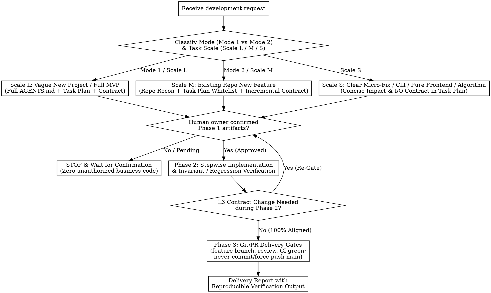

# Contract-First MVP & Scoped Development Skill (`dev-skill`)

## Overview

Turn vague, one-sentence feature requests from novices or teammates (such as *"我要做后端的订单模块"* or *"帮我写个校园二手交易系统"*)—as well as scoped features or fixes in existing repositories—into bounded, contract-governed, verifiable deliveries.

Alongside `drawing-skill` (architecture/mechanism diagrams) and `writing-skill` (evidence-governed technical documents), `dev-skill` governs the **AI-assisted development lifecycle**:

> **1. Contract Gate before business code (`契约先行，点头再动代码`).** Never write business code directly from a vague request. First converge scope, architecture, file whitelist, and contracts (`AGENTS.md` + `docs/tasks/<task>.md` + `CONTRACT_PATH`), then stop for human confirmation.
> **2. Contract is the single source of truth (`契约即唯一真相，分级变更重确认`).** Table names, column names, state enums, invariants, route paths, and I/O schemas in code must match `CONTRACT_PATH` 100%. Behavioral or scope changes (L3) require human re-confirmation before editing code.
> **3. Stepwise execution with real verification (`小步快跑，真实命令与不变量验收`).** Build in verifiable steps and execute real verification commands covering happy paths, concurrency/transaction invariants, and authorization/error boundaries.
> **4. Evidence-backed outcomes (`验收可用结果，而非仅验证链路跑通`).** Define observable acceptance items and their evidence before implementation. Passing a few examples establishes those cases only; report sample size, failures, abstentions, and remaining gaps instead of unsupported completion percentages.
> **5. Git delivery gates after verification (`验证通过后再走分支与 PR，禁止直改 main`).** After Phase 2 is green, integrate through a feature branch, Conventional Commits, review, and CI. **Never commit or force-push directly to `main`** — that delivery is an automatic reject.

**Violating the letter of the Phase 1 Contract Gate is violating the spirit of this skill.**

---

## 1. Mode & Scale Routing (`双模式 × 三级规模路由`)

Not every task is a full database-backed backend. First classify the request along **Repository Mode** (`Mode 1` vs `Mode 2`) and **Task Scale** (`Scale L` / `Scale M` / `Scale S`), then expand only the contract sections the task genuinely needs.

### 1.1 Repository Mode (`仓库起点模式`)

| Mode | Triggering Scenario | Mandatory First Action |
|---|---|---|
| **Mode 1 — 从零立项 (`Greenfield MVP`)** | Starting a new project or standalone service from an empty workspace or a single sentence (e.g., *"我要做后端的二手书交易模块"*). | Do **not** write business code. Generate root `AGENTS.md`, task plan `docs/tasks/<task-slug>.md`, and contract at `CONTRACT_PATH` (default `docs/contract.md`). |
| **Mode 2 — 已有仓库开发 (`Brownfield / Scoped Dev`)** | Adding a feature, submodule, or fix inside an existing repository. | **Pre-Contract Recon**: Inspect directory tree, dependency manifests, existing `AGENTS.md`, migrations/entities, and OpenAPI/interface docs. Preserve existing `AGENTS.md` long-term rules; put current task scope & file whitelist in `docs/tasks/<task-slug>.md` and incremental contract in `docs/contracts/<module>-contract.md`. |

### 1.2 Task Scale Triage (`任务规模三级路由 — 按需展开，拒绝过度模板化`)

Database tables, HTTP endpoints, and external service sections must be expanded **only as actually needed** by the task. Never invent fake database tables or REST endpoints just to fill a template.

**Conditional workflow guidance**: For search, recommendation, RAG, or AI evaluation features, read [Evidence-Driven Workflows](references/evidence-driven-workflows.md) during Recon / Phase 1 and use its applicable checks in Phase 2. It covers purpose contracts, source spans, executable artifacts, complementary selection, learner constraints, query abstraction, and fair evaluation. Ordinary CRUD, CLI, and frontend tasks do not need this pipeline.

| Scale | Task Type (`任务类型`) | Appropriate Workflow & Artifacts (`合适的流程与产物`) | Contract Sections to Expand (`按需展开范围`) |
|---|---|---|---|
| **Scale L** | **模糊的新项目 (`Vague New Project / Full MVP`)** | Full MVP convergence, architecture design, `AGENTS.md` + `docs/tasks/<task-slug>.md` + `docs/contract.md`, Phase 1 confirmation, then 3-step implementation (`templates/AGENTS.template.md` + `templates/contract.template.md`). | Full sections needed by the system: DB schema + state machine + invariants (if stateful), HTTP API / CLI / Agent JSON schema, and Mock boundaries. |
| **Scale M** | **已有项目的新功能 (`New Feature in Existing Repo`)** | Repository reconnaissance (`Recon`), preserve root `AGENTS.md` (incremental edit only if global rules change), create `docs/tasks/<module>.md` (scope + File Whitelist) and `docs/contracts/<module>-contract.md` (or reuse existing OpenAPI/migrations), confirm, then implement & run regression suite. | Only the new/modified tables, endpoints, or component props, plus upstream/downstream compatibility with existing modules. |
| **Scale S** | **边界明确的小修复 / 纯前端 / CLI / 算法模块 (`Clear Bugfix / Non-DB / Algorithm / CLI`)** | Concise impact note, file whitelist, input/output signature or behavioral invariant update, and targeted verification command inside `docs/tasks/<task-slug>.md` (`templates/task-plan.template.md`). | **Omit DB DDL and REST sections if not applicable.** Specify function/CLI/component inputs, outputs, error cases, and targeted test commands. |

---

## 2. Separation of Long-Term Rules vs. Task Plan (`长期规则与当轮任务解耦`)

To prevent multi-module collaboration in existing repositories from overwriting project-wide steering rules:

1. **`AGENTS.md` holds Long-Term Repository Rules (`仓库级长期规则`)**:
   - Tech stack, architectural layering, unified response/error envelope, global environment variables, and permanent coding red lines.
   - **Brownfield Preservation Rule**: If `AGENTS.md` already exists, **keep its existing constraints intact** and make only minimal incremental additions when global conventions change. Never rewrite the entire project's `AGENTS.md` for a single submodule task.
2. **`docs/tasks/<task-slug>.md` holds the Current Task Plan (`当轮任务范围、白名单与验收条件`)**:
   - Use `templates/task-plan.template.md` to store the current iteration's MVP `In-Scope` / `Non-Goals`, **File Whitelist** (including dependency files like `requirements.txt` or `package.json` if dependencies change, and `tests/verification.json` when runtime invariant mapping is used), explicit `CONTRACT_PATH` pointer, phase status, and step verification commands.
   - *(Note: For a standalone single-module Mode 1 exercise, the task plan block may either live in `docs/tasks/mvp-init.md` or be embedded in `AGENTS.md` §5, provided `CONTRACT_PATH` and the File Whitelist are explicitly declared.)*
3. **Reuse Existing Authoritative Specs (`复用已有权威契约与真源层级`)**:
   - If the repository already maintains OpenAPI/Swagger specs, SQL/Alembic/Prisma migrations, or shared protobuf/schema files, **reuse them first** and declare the **Source of Truth Hierarchy (`权威真源层级`)** in `AGENTS.md` and `docs/tasks/<task-slug>.md` instead of creating conflicting duplicate schemas.
   - Always reference the active contract via a single explicit `CONTRACT_PATH` (e.g., `docs/contract.md` for single-module projects, `docs/contracts/<module>-contract.md` for multi-module repositories, or `NONE (Scale S 内联契约)` when a `Scale S` task embeds its lightweight contract directly in `docs/tasks/<task-slug>.md`).

---

## 3. Phase 1 — Hard Contract Gate (`契约门禁：点头前绝不写业务代码`)

When receiving a development request, **STOP in Phase 1**. Produce the required Phase 1 artifacts for the task's Scale and wait for human confirmation.

### 3.1 Artifact Checklist (`AGENTS.md` + `docs/tasks/<task-slug>.md` + `CONTRACT_PATH`)

1. **`AGENTS.md` (Long-Term Steering Contract — `templates/AGENTS.template.md`)**
   - **Architecture & Directory Structure**: Battle-tested, locally runnable stack, layered responsibilities, and file-level directory structure.
   - **Source of Truth Hierarchy & `CONTRACT_PATH`**: Explicit pointer to `CONTRACT_PATH` and `TASK_PLAN_PATH`, plus precedence rules when OpenAPI or DB migrations exist.
   - **Global Environment & Verification Conventions**: Runtime/DB versions, `.env.example` variable table, quickstart commands, and SQLite/DB connection rules (e.g., `PRAGMA foreign_keys = ON`).
   - **Long-Term Guardrails & Contract Change Protocol**: Coding conventions, L1/L2/L3 contract change rules, and anti-hallucination red lines.

2. **`docs/tasks/<task-slug>.md` (Task Scope, Whitelist & Verification Plan — `templates/task-plan.template.md`)**
   - **Task Metadata**: `TASK_ID`, `MODE`, `SCALE` (`L/M/S`), `CONTRACT_PATH`, and `PHASE_STATUS`.
   - **In-Scope Actions & Non-Goals**: Concrete verifiable actions and explicit exclusions (`Non-Goals` / `不做项` / `非目标` / `明确不做` / `长期边界`).
   - **File Whitelist & Read-Only Boundaries**: Every file allowed to be created or modified (must include `requirements.txt` / `package.json` if dependencies are added/updated, and `tests/verification.json` or `tests/**` for Phase 2 runtime acceptance mapping).
   - **Stepwise Verification Commands**: Exact commands for Step 1, Step 2, and Step 3.
   - **Outcome Acceptance & Evidence**: Task-specific `acceptanceItems`, pass/fail criteria, evidence producer/artifact path, and known untested boundaries. For retrieval features, separate candidate discovery from downstream validation; a strict filter passing fixed candidates does not establish live-search success.

3. **`CONTRACT_PATH` (`docs/contract.md` or `docs/contracts/<module>-contract.md` — `templates/contract.template.md`)**
   - **Database Schema & Enforcement Layer** *(when DB is involved)*:
     - **Field Dictionary**: Column name, type/length, nullable, default, key/index name, **Enforcement Layer (`保证层`: `DB Constraint` / `Request Validation` / `Service Invariant`)**, and business description.
     - **100% Template & DDL Self-Consistency**: Every named index (`idx_*`, `uk_*`), field length/constraint, and status enum declared in the Field Dictionary must match the executable SQL DDL and API validation rules 100%.
     - **State Enums & Complete Transition Matrix**: Every status value declared in the Field Dictionary (including non-happy-path states like `OFF_SHELF` or `CANCELLED`) must have defined entry conditions (`From`), exit rules (`To`), terminal/non-terminal markers, and cross-table side effects.
     - **Database Connection Enforcement Notes**: For SQLite, explicitly mandate `PRAGMA foreign_keys = ON;` on every database connection initialization so foreign key constraints are actually enforced at runtime.
   - **Core Business Invariants, Concurrency & Authorization Rules (§1.5 Mandatory for Stateful Logic)**:
     - See Section 4 below.
   - **API / I/O Contract & Integration Boundaries**:
     - Unified response envelope, business error codes, request/response examples, and explicit `REAL` vs `MOCK` boundaries.

### 3.2 Phase 1 Gate Stop Condition

After generating or updating the Phase 1 artifacts:
- **Do NOT create or modify any `.py`, `.ts`, `.js`, `.java`, `.go`, or business implementation files.**
- Ask the human owner to confirm the scope, file whitelist, data/API contracts, and business invariants before entering Phase 2.

---

## 4. Verifiable Business Invariants (`可验证业务不变量、并发事务与权限边界`)

For any module involving state transitions, resource locking, or multi-actor actions, `CONTRACT_PATH` (§1.5) and Phase 2 tests **must** explicitly define and verify these four **domain-neutral** categories, specifying the **Enforcement Layer (`DB Constraint` + `Request Validation` + `Service Invariant`)** for each. Use the module's own nouns (coupon, ticket, inventory slot, job, document). The campus second-hand book order is a worked example in parentheses, not a required vocabulary. Stateless Scale S tasks that have no shared mutable resource may mark a category `N/A` and still define the output invariant they do have (often an `AC-N`).

1. **Uniqueness / single-active-resource (`唯一性 / 单一有效待处理资源`, 防重)**:
   - At most one active / in-progress record may exist for a given resource at a time. A second claimant is rejected or loses the race.
   - Worked example (book order): *A single book may have at most ONE active (`PENDING`) order at any time*, enforced by `DB Constraint` (partial unique index `uk_orders_active_book ON orders(book_id) WHERE status = 'PENDING'`) **AND** `Service Invariant` (conditional atomic update `UPDATE books SET status = 'RESERVED' WHERE id = ? AND status = 'ON_SALE'` verifying `rowcount == 1`, conflict `40901`).
2. **Atomicity of related mutations in one transaction (`同事务原子性`)**:
   - Mutations that must succeed or fail together run in **one database transaction**. If any step fails, the transaction rolls back so callers never observe an orphan lock or a half-written record.
   - Worked example (book order): resource locking (`books.status: ON_SALE -> RESERVED`) and order creation (`INSERT INTO orders`) share one transaction.
3. **Precise release + terminal-state idempotency (`精准释放与终态幂等`)**:
   - Releasing or reversing a hold touches **only** the resource bound to that operation, and only from the expected held state. Repeating the operation after a terminal state must not apply a second side effect; reject it with an explicit conflict (or return a documented no-op).
   - Worked example (book order): cancelling (`PENDING -> CANCELLED`) releases only that order's book, and only `RESERVED -> ON_SALE`. Repeating `COMPLETED` / `CANCELLED` / `SOLD` returns `40903 INVALID_ORDER_TRANSITION`.
4. **Ownership / authorization vs mock identity (`归属人鉴权 vs 模拟身份`)**:
   - Even when an MVP uses simplified/mock authentication (no OAuth2/JWT), the contract must separately specify:
     - **Identity carrier (`身份载体`, may be `MOCK`)**: how the caller is named (header, token, or body field).
     - **Authorization rule (`归属人鉴权`, `REAL`)**: who may perform each mutation. Unauthorized callers receive a deterministic forbidden error.
   - Worked example (book order): carrier `X-User-Id` or `seller_id` / `buyer_id` / `operator_id`; only `books.seller_id` may off-shelf/re-list; only that order's `buyer_id` or `seller_id` may complete or cancel; `buyer_id != seller_id` on create; others get `HTTP 403` / `40301 FORBIDDEN_NOT_OWNER`.

---

## 5. Phase 2 — Stepwise Coding & Contract Change Protocol (`分步开发与契约变更协议`)

Enter Phase 2 **only after** human confirmation of Phase 1.

### 5.1 Three Verifiable Steps (Adapted by Scale)

- **Step 1: Environment, Skeleton & Schema (`环境骨架与数据层`)**
  - Create `.env.example`, dependency manifest (`requirements.txt` / `package.json`), and schema/models matching `CONTRACT_PATH` 100% (including `PRAGMA foreign_keys = ON` per connection for SQLite).
  - Run Step 1 verification command (schema DDL execution, FK check, model import).
- **Step 2: Core Service, Invariants & Endpoints (`核心业务、不变量与接口实现`)**
  - Implement service logic and endpoints within the approved **File Whitelist**.
  - Run Step 2 automated tests covering **not only happy paths**, but the four categories in Section 4 whenever they apply:
    1. Uniqueness / single-active-resource contention (book-order example code `40901`);
    2. Atomic rollback of related mutations (no orphan lock or half-written row);
    3. Ownership / authorization rejection distinct from mock identity (book-order example code `40301`);
    4. Precise release and repeat transition on a terminal state (book-order example code `40903`), plus foreign-key enforcement when the schema has foreign keys.
  - Non-trading modules keep these categories and use their own error codes. Do not rename a coupon or ticket conflict to `BOOK_NOT_AVAILABLE` just to match the example.
  - When evaluating Python/unittest workspaces with `tests/evaluate_workspace.py --scene phase2_delivery`, provide `tests/verification.json` mapping `"initialization"` and every active contract `INV-N` / `AC-N` ID to its `unittest` selector and production call targets (`relative/file.py:callable`; see `examples/minimal-repro/verification.json`).
- **Step 3: Runtime & End-to-End Smoke Verification (`真实运行与端到端验收`)**
  - Run the live service or reproducible test runner and record actual terminal output.
  - **Honesty Red Line**: If any test or verification command fails, **never claim completion**. Report the exact failure output, fix the root cause, and re-run until green.

### 5.2 Three-Tier Contract Synchronization Protocol (`契约变更三级确认边界`)

To prevent an agent from silently editing `CONTRACT_PATH` during Phase 2 and then claiming *"code matches the new contract 100%"*, all mid-flight adjustments are governed by three strict tiers:

| Tier | Change Type (`变更类型`) | Examples (`具体表现`) | Mandatory Handling (`默认处理规则`) |
|---|---|---|---|
| **L1** | **Clarification / Editorial (`修正文案、补充示例，不改变行为`)** | Fixing typos, adding request/response JSON examples, clarifying field descriptions without altering any field name, type, length, enum, route, or invariant. | **Direct Sync (`直接同步`)**: Update `CONTRACT_PATH` directly and note the editorial sync in the delivery summary. |
| **L2** | **Internal Implementation Detail (`实现细节调整，不改变对外约定`)** | Extracting private helper functions, internal query tuning, or code comments within the approved File Whitelist and schema. | **Execute in Scope (`在已授权范围内执行`)**: Proceed without changing external contracts or pausing workflow. |
| **L3** | **Breaking / Behavioral / Scope Change (`删除/修改字段、改变状态流转或权限、扩大范围或白名单`)** | Adding/removing/renaming columns or JSON fields, changing field types/lengths/semantics, altering state transitions or auth rules, changing error codes, or touching files outside the File Whitelist. | **Mandatory Re-Gate (`提交具体差异，重新确认受影响部分`)**: **STOP coding.** Present the exact contract diff and impact analysis to the human owner and wait for explicit re-approval before modifying implementation code. |

---

## 6. Phase 3 — Git / PR Delivery Gates (`Git 协作交付门禁：Fork、功能分支、评审与 CI`)

Enter Phase 3 **only after** Phase 2 verification commands are green. Phase 3 is a delivery phase of this skill, not a separate skill, and it does **not** change Mode 1 / Mode 2 or Scale L / M / S artifact routing. Scale S still omits unused database and HTTP sections. Every scale uses the same Git red line when the change is integrated through Git.

> **Hard red line (`硬红线`, automatic reject):** never commit or force-push directly to `main`. A delivery that lands commits on `main`, or runs `git push --force` / `git push --force-with-lease` against `main`, is rejected even if tests are green. Creating `feature/<task-slug>` *from* `main` is allowed only when the repository has no `develop` and no other documented integration branch. Those commits still live on the feature branch, never on `main`.

### 6.1 Six Stages, Twelve Steps

| Stage | Steps | What to do |
|---|---|---|
| **1. Repo + branch (`仓库与分支`)** | 1–2 | **1.** If an upstream exists and the contributor cannot push to it, fork upstream and use the fork as the contributor remote. **2.** Check out `feature/<task-slug>` from `develop`, or from the integration branch named in `AGENTS.md` / the task plan. Fall back to branching *from* `main` only when no `develop` (and no other integration branch) exists. Bind `<task-slug>` to `TASK_ID` and `TASK_PLAN_PATH` (`docs/tasks/<task-slug>.md`). |
| **2. Local self-check (`本地自检`)** | 3–4 | **3.** Run the task plan's unit tests and integration tests. **4.** Run linter / style checks and the coverage gate in §6.2. |
| **3. Normative commits + push (`规范提交并推送`)** | 5–6 | **5.** Write Conventional Commits subjects: `<type>(<optional-scope>): <description>` with `type` one of `feat`, `fix`, `docs`, `style`, `refactor`, `perf`, `test`, `build`, `ci`, `chore`, `revert`. Example: `feat(book-order): enforce single-active resource lock`. **6.** Push `feature/<task-slug>` to the contributor remote (the fork's `origin`, or this repo's `origin` when the contributor may push there). Do not push `main`. |
| **4. Open PR (`开启拉取请求`)** | 7–8 | **7.** Open a pull request into `develop` (or the documented integration branch) with `templates/pull-request.template.md`: feature, changes, approach, `CONTRACT_PATH`, task-plan path, verification command results, and a Conventional Commits summary. **8.** Request review from the repository owner and at least two other reviewers when the team has them. Solo repository: write `solo` and use the owner self-check in step 10. |
| **5. Review + pipeline (`评审与流水线`)** | 9–10 | **9.** Resolve every review discussion thread. **10.** Wait until CI/CD is green and obtain at least two LGTM / approvals when team size allows. Solo: one owner self-check recorded on the PR, plus CI green. |
| **6. Merge + release (`合入与发版`)** | 11–12 | **11.** Squash-merge into `develop` (or the documented integration branch). **12.** Wait for the next release cut that promotes the integration branch. Do not fast-forward your own commits onto `main`. |

When `main` itself is the only integration branch, the pull request may target `main`, but the branch you commit on is still `feature/<task-slug>`. State that fallback in the PR. Squash-merge through the pull request is not a direct commit to `main`.

### 6.2 Coverage Gate (`COVERAGE_GATE`, configurable)

- If the project **already measures** coverage (`coverage.py`, `pytest-cov`, Istanbul/nyc, `go test -cover`, or an equivalent), the default gate is **≥ 95%** (`COVERAGE_GATE: 95`).
- If the repository already documents a different threshold (CI config, `AGENTS.md`, or the task plan), **use that threshold** and record it. Do not silently replace an existing gate with 95%.
- If the project **does not** measure coverage, do not claim the gate passed. Set `COVERAGE_GATE: unset` in the task plan and write the threshold you will adopt once measurement exists.
- This skill does not embed a CI system. Record the commands and exit codes in the task plan and the pull request. A red local gate blocks step 6.

### 6.3 Solo Repositories and Missing `develop`

| Situation | Required behavior |
|---|---|
| Owner plus at least two other reviewers | Request the owner and those reviewers; require at least two LGTM / approvals, every thread resolved, and CI green. |
| Solo repository | One owner self-check written on the PR, plus CI green. Do not invent reviewers. |
| `develop` exists | Branch from `develop`; squash-merge back into `develop`. |
| No `develop`, but another integration branch is documented | Use that branch the same way. |
| No `develop` and no other integration branch | Create `feature/<task-slug>` from `main`, open the PR against `main` as the fallback integration target, and still never commit or force-push on `main`. |

Protected-branch rules and release automation stay in the repository's own CI. Do not add a workflow file to the target project unless it is already on the File Whitelist. A filled checklist lives in `examples/phase3-checklist.md`.

---

## 7. Common Anti-Patterns & Rationalization Counter-Table

| # | Anti-Pattern (`常见翻车点`) | `dev-skill` Interception Rule |
|---|---|---|
| **1** | **Zero-Contract Code Dump (`不写契约直接吐代码`)** | **Phase 1 Gate**: Zero business code before `AGENTS.md` / `docs/tasks/<task>.md` and `CONTRACT_PATH` are confirmed. |
| **2** | **Template Overkill on Small Tasks (`小改动硬套重型后端模板`)** | **Scale S / M Routing**: Use `Scale S` for bugfixes, CLI tools, or pure frontend/algorithm modules; never invent fake tables or HTTP endpoints. |
| **3** | **Self-Approved Contract Drift (`私改契约伪装 100% 对齐`)** | **L3 Re-Gate Protocol**: Any change to field semantics, state transitions, auth rules, or scope requires human re-confirmation first. |
| **4** | **Overwrite Global `AGENTS.md` in Brownfield (`新增子模块覆盖全局规则`)** | **Long-Term vs. Task Split**: Keep long-term repo rules in `AGENTS.md`; put current task scope and File Whitelist in `docs/tasks/<task-slug>.md`. |
| **5** | **Fake-Done Stubs or False-Green Claims (`假数据桩代码或测试失败仍报完成`)** | **Step 2/3 Invariant & Workspace Evaluation**: Verify atomic transactions, FK enforcement, and real test outputs via `tests/evaluate_workspace.py`. |
| **6** | **Direct Commit or Force-Push to `main` (`在 main 上直接提交或强推`)** | **Phase 3 Red Line**: Automatic reject. Integrate only through `feature/<task-slug>`, a pull request, and squash-merge into `develop` or the documented integration branch. |

| Excuse (`AI 常见借口`) | Reality (`工程铁律`) |
|---|---|
| *"I updated `docs/contract.md` myself to drop that tricky field, so code and contract are 100% aligned."* | Deleting a field or changing state transitions is an **L3 change**. Self-modifying the contract without human re-confirmation is a contract violation. |
| *"SQLite created the tables without error, so foreign keys are working."* | SQLite disables `PRAGMA foreign_keys` by default on every new connection. You must enable `PRAGMA foreign_keys = ON` per connection and verify it in tests. |
| *"Testing sequential duplicate orders is enough to prove locking works."* | Sequential success does not prove the four categories. Test single-active-resource contention, same-transaction rollback, ownership rejection, and terminal-state repeat (book-order examples: `40901`, `40301`, `40903`). |
| *"CI is green locally, so I will commit straight to `main`."* | Phase 3 rejects any direct commit or force-push to `main`, including from the repository owner. |
| *"This module is not a bookstore, so I can skip INV-1..INV-4."* | The four categories are domain-neutral. Instantiate them with this module's resources, or mark a category `N/A` when no shared mutable state exists. |

---

## 8. Pre-Completion Verification Checklist (`交付前自检清单`)

### Phase 1 Gate Checklist (Before Asking Human to Confirm)
- [ ] Mode (`Mode 1` / `Mode 2`) and Scale (`Scale L` / `Scale M` / `Scale S`) explicitly identified.
- [ ] In Mode 2, existing `AGENTS.md`, OpenAPI specs, and migrations were inspected and preserved; task scope and File Whitelist are isolated in `docs/tasks/<task-slug>.md`.
- [ ] `CONTRACT_PATH` is explicitly declared and consistent across `AGENTS.md` and `docs/tasks/<task-slug>.md`.
- [ ] In `CONTRACT_PATH`, all Field Dictionary indexes (`idx_*`, `uk_*`), field lengths, and status enums (including `OFF_SHELF` / `CANCELLED`) match the SQL DDL and API validation 100%, with each rule's **Enforcement Layer** (`DB Constraint` / `Request Validation` / `Service Invariant`) labeled.
- [ ] **Zero** unauthorized business implementation files created or modified yet.

### Phase 2 Delivery Checklist (Before Claiming Development Complete)
- [ ] All modified/created files are strictly inside the approved **File Whitelist** (including `requirements.txt` / dependency files and `tests/verification.json`).
- [ ] Code matches `CONTRACT_PATH` 100%; any L3 contract change was explicitly re-approved by the human owner before implementation.
- [ ] Stateful logic enforces all 4 invariant categories (single-active-resource, same-transaction atomicity, precise release + terminal-state idempotency, ownership vs mock identity), in this module's language. Book-order codes `40901` / `40301` / `40903` are examples, not required names.
- [ ] Step 1, Step 2, and Step 3 verification commands were executed with all tests passing (zero unreported failures, `TODO` stubs, or unmapped `INV-N`/`AC-N` items in `tests/verification.json`). Linter / style checks ran, and `COVERAGE_GATE` was recorded (existing project threshold, default ≥95% when coverage is already measured, or `unset` with the chosen starter threshold).
- [ ] Outcome claims map to acceptance items and reproducible evidence; tested cases, untested boundaries, and `REAL` / `MOCK` dependencies are stated. For AI workflows, report abstentions and recommendation success alongside erroneous recommendations, and distinguish simulated baselines from actual product comparisons.

### Phase 3 Delivery Checklist (Before Squash-Merge)
- [ ] Current branch is `feature/<task-slug>` tied to `TASK_ID` / `TASK_PLAN_PATH`, cut from `develop` or the documented integration branch (`main` only as the base when no integration branch exists).
- [ ] Commits use Conventional Commits. The feature branch was pushed to the contributor remote. **No commit and no force-push landed on `main`.**
- [ ] Pull request filled from `templates/pull-request.template.md` (feature, changes, approach, `CONTRACT_PATH`, task-plan path, verification results, commit summary, reviewers). Link recorded on the task plan.
- [ ] Review threads are resolved, CI/CD is green, and approvals match team size (≥2 LGTM when available; solo = 1 owner self-check + CI green).
- [ ] Squash-merge target is `develop` or the documented integration branch, then wait for the next release cut.

---

## 9. Templates, Reproducible Examples & Verification Suite

- [Evidence-Driven Workflows](references/evidence-driven-workflows.md) — Conditional design and acceptance guidance for search/recommendation/RAG, including query refinement and fixed-material vs. end-to-end evaluation; contains illustrative examples, not production-run evidence.
- `templates/AGENTS.template.md` — Template for repository-level `AGENTS.md` steering rules, `CONTRACT_PATH` hierarchy, and the Phase 3 `main` red line.
- `templates/task-plan.template.md` — Template for per-task scope, Scale routing (`L/M/S`), File Whitelist, linter/coverage gates, and the Phase 3 checklist (`docs/tasks/<task-slug>.md`).
- `templates/contract.template.md` — Self-consistent template for `CONTRACT_PATH` (`docs/contract.md` or `docs/contracts/<module>-contract.md`) with Enforcement Layers, SQLite FK pragma, full state transitions, and the four domain-neutral invariants (book order is the worked example).
- `templates/pull-request.template.md` — Pull request prompts for `CONTRACT_PATH`, task-plan path, verification results, Conventional Commits summary, and reviewers.
- `examples/phase3-checklist.md` — Filled Phase 3 checklist (branch, PR link, reviewers) using the book-order task as the example.
- `examples/one-sentence-to-mvp.md` — End-to-end walkthrough demonstration (with explicit evidence boundary notes) + link to the runnable minimal reproduction.
- `examples/minimal-repro/` — Zero-dependency runnable Python + SQLite implementation, invariant test suite, and `examples/minimal-repro/verification.json` runtime mapping (`python3 -m unittest discover -s examples/minimal-repro -v`).
- `tests/validate_structure.py` — Layer 1 deep structural, YAML schema, and template consistency validator (`python3 tests/validate_structure.py`).
- `tests/evaluate_workspace.py` — Layer 2 behavioral workspace evaluator checking Phase 1 gate compliance, Mode 2 file whitelist isolation, contract alignment, and runtime test verification (`python3 tests/evaluate_workspace.py --self-test`).
- `tests/test_evaluate_workspace.py` — Unit and adversarial regression suite for the Layer 2 workspace evaluator (`python3 -m unittest discover -s tests -p 'test_evaluate_workspace.py' -v`).
- `CHANGELOG.md` — Version history (`v1.0.0` -> `v1.3.0`).
